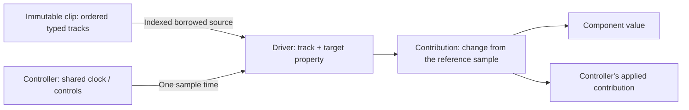
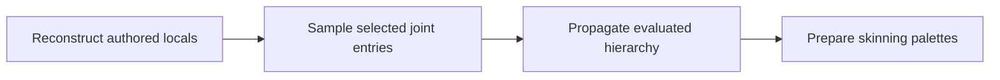

# Property and Skeleton Animation

[Architecture](../architecture/runtime.md#animation-and-constraints) · [Build guide](building.md) · [Strategy](../plans/runtime-and-rendering.md#evaluation-strategy)

Property animation is standard and works headlessly without skeletons or constraint declarations. Controllers are World-owned system objects, not entity components. Hosts advance time; clients submit controls.

Interactive example: `python tools/ipp.py dev gallery` → **Lighting, Picking & Animation**. See [gallery controls](../../examples/demos/scenes/lighting/scene.tsx).

## Clips, tracks and drivers

A driver may set `repeat: true` to wrap its source clip at that clip's duration while sharing the controller clock. Other drivers hold their clip endpoints as before. The controller still completes or loops at its longest source duration, so a short repeating base gesture can stay synchronized with a longer route. Pending bindings hold the whole controller clock; pause, seek and persistence use the same time mapping.



- `AnimationTrack<T>` stores contiguous typed keys/Bézier handles. Track indices survive decode/reload; clips own no targets/clocks.
- IPPA source hints describe static offsets, dynamic property names or joint ordinals, not bindings. Drivers supply source/variant/track/entity/exact coverage; repeated hints may target different entities.
- Structural tracks use the `EntityLink` target and Step-only `EntityPlacement` keys. Optional parent/before `u32` slots resolve through each driver's `entity_bindings` table in its World; immutable clips never store runtime entity handles for these keys. Each selected key, seek or loop boundary resolves placement once, then holds the resulting link and sibling order until another transition or stop.
- Static properties select one field or a complete Transform quaternion. Named dynamic properties bind through validated component property identities. Row properties bind by their generated row offset (slot and property); removing the row or clearing an optional property drops only that driver, components may keep row properties from animation entirely, and text row properties never bind. Use matching generated descriptors; native/WASM offsets may differ.

Core controller admission and restoration check the selected World's manifest before asset readiness: structural tracks require `Animation` and `EntityLinks`, component tracks require their component evaluator, and joint tracks also require `JointAnimation`. With a ready Host-owned clip, structural playback can run in an animation-only World without allocating component pages or selecting spatial propagation. Unsupported targets return `UnsupportedDependency`; they do not wait indefinitely for absent evaluators. See the [selected-target tests](../../crates/ipp-core/tests/selected_target_admission.rs) for direct-core coverage; generated transport contracts must carry these selections and targets separately.

One clock driving two existing Scalar entities:

```ts
import { Scalar, encodeAnimationClip } from "./generated.js";

const property = {
  component: Scalar.id,
  offsets: [Scalar.fields.value.offset],
};
const bytes = encodeAnimationClip({
  duration: 2,
  tracks: [{
    property,
    keys: [
      { time: 0, value: { kind: "f32", value: 0 } },
      { time: 2, value: { kind: "f32", value: 10 } },
    ],
  }],
});
const clipSource = await client.createAsset(10, bytes.buffer);

const controllerId = await client.createAnimationController({
  drivers: [firstTargetId, secondTargetId].map(target => ({
    source: clipSource.source, track: 0, target, property,
  })),
  speed: 1,
  looping: false,
});
await client.controlAnimationController(controllerId, { action: "play" });
```

| Sampling | Behavior |
| --- | --- |
| Controller duration | Longest selected clip; shorter tracks hold endpoints; separate controllers keep independent clocks |
| Numeric | Step, linear or Bézier; solve Bézier time before value |
| Discrete | Entity/bool/string/bytes/integers use step or integer interpolation and write their sample; no additive mode |
| Quaternion | Normalized shortest-arc spherical interpolation |
| Encoder defaults | Numeric linear; discrete/final keys step; Rust final keys explicitly use `AnimationInterpolation::Step` |
| Driver controls | `weight`, `additive`, `referenceTime`, `repeat`; defaults full weight, change from the clip's start, zero reference time, no repetition |
| Contributions | Float, float vector/matrix, rotation and pose drivers add `weight × (sample − reference)`; the reference is the clip's start, or `referenceTime` with `additive`. Rotations compose on the right |
| Traversal | Controller identity then description order; absolute writes before contributions; contributions of overlapping controllers sum; absolute writers are last-writer-wins |

## Joint targets and pose keyframes

Select the skinning Systems in the World. A Skeleton target uses `{ joints: [1] }` with matching local TRS keys:

```ts
const bytes = encodeAnimationClip({
  duration: 2,
  tracks: [{
    joints: [1],
    keys: [
      { time: 0, value: { kind: "pose", value: [{ translation: [0, 1, 0] }] } },
      { time: 2, value: { kind: "pose", value: [{
        translation: [0, 1, 0],
        rotation: [0, 0, Math.SQRT1_2, Math.SQRT1_2],
      }] } },
    ],
  }],
});
// After uploading bytes as asset type 10:
const controllerId = await client.createAnimationController({
  drivers: [{
    source: clipSource, track: 0, target: skeletonEntityId,
    property: { joints: [1] },
  }],
});
```

- Selections: nonempty ascending ordinals, matching key/handle transform counts, fitting the target skeleton. Omitted TRS defaults to zero translation, identity rotation and unit scale.
- Translation/scale interpolate numerically; rotations as quaternions. Invalid scales reject the whole controller sample. Unselected joints keep their prior values.
- `AnimationTrack<Vec<Transform>>` binds the component incarnation, skeleton source and selected internal locals. The Skeleton rebuilds its authored locals every frame before animation, so joint contributions apply in full each frame and nothing is kept for them; generic fields and `Skeleton.joints` are not rewritten.



Discrete pose-input samples rebase unkeyed locals while preserving earlier sampled entries via temporary sparse coverage. Replacement invalidates before storage reuse; explicit Play/update may rebind. Temporary unload freezes playback until readiness; resource removal ends bindings.

## Controls, readiness and persistence

Controller speed is finite and signed. Positive playback advances toward the clip duration; negative playback advances toward zero. Nonlooping playback completes at the endpoint selected by its direction, while looping playback wraps in either direction. `Restart` chooses the directional endpoint. `PlayAtSpeed` changes speed and resumes atomically without rewinding, which is useful for reversing a controller that just reached an endpoint.

`Transition` crossfades to a replacement controller description over Host time with linear or smoothstep easing. The outgoing and destination clips keep independent signed clocks, while pause and pending assets freeze both clocks and fade progress. Destination time may restart, preserve local time, match normalized phase or seek exactly. The first ready frame samples elapsed zero; a zero-duration transition cuts directly to the destination.

Transition preparation compiles a sparse union of numeric, quaternion and joint targets and blends the two sides' contributions. Targets present on only one side blend to or from no contribution, and joint coverage is combined by ordinal so partial gestures can crossfade with full-body motion. Interrupting a fade captures the current sparse contribution as a new fixed origin that fades out; a pending crossfade writes nothing and its contributions stay in their fields. Discrete, resource-bearing and structural tracks are rejected for transitions and remain available through ordinary playback.

For a reversible hover clip, use `playAtSpeed` with `1` on entry and `-1` on exit. To change motion clips, supply the destination drivers and a transition policy:

```ts
await client.controlAnimationController(controllerId, {
  action: "playAtSpeed", speed: -1,
});
await client.transitionAnimationController(controllerId, {
  description: { drivers: runDrivers, speed: 1, looping: true },
  duration: 0.25,
  easing: "smoothstep",
  startTime: { policy: "matchPhase" },
});
```

A transition preserves appearance when interrupted; it does not guarantee matching velocity or foot placement. `matchPhase` aligns normalized clip time, so authored gait phases must correspond.

```ts
const unsubscribe = client.onPlaybackEvent(event => {
  console.log(event.tick, event.controller.id, event.kind, event.controller.time);
});
await client.controlAnimationController(controllerId, { action: "pause" });
await client.controlAnimationController(controllerId, { action: "seek", time: 0.5 });
const inspection = await client.inspect();
const controller = inspection.controllers?.find(value => value.id === controllerId);
// controller.state === "paused", controller.time === 0.5
await client.updateAnimationController(controllerId, {
  ...controller.description, speed: 2, looping: true,
});
await client.controlAnimationController(controllerId, { action: "restart" });
await client.deleteAnimationController(controllerId);
unsubscribe();
```

Create/update/delete/correlated controls resolve after ordered mutation, sharing entity-batch ingress. `client.playback(id, control)` is fire-and-forget; use `controlAnimationController` to observe rejection.

| State/control | Contribution and time |
| --- | --- |
| Waiting | Hold requested time until all sources bind; resource failures emit transitions; manager owns recovery |
| Pause / completed | Keep the contribution |
| Stop | Subtract the applied contribution from each live field; leave absolute writes and placements; retain position |
| Seek | Freeze exact next sample, including followed by Play |
| Restart | Reset to the directional start and play |
| Completion | Hold endpoint |

Receipts/resource inspection establish readiness. Events carry identity/status/time; inspection supplies descriptions.

Binding matching includes generation, incarnation and exact coverage. A controller keeps one applied contribution per target it drives and counts a new total as applied only once its component write lands. For float fields it keeps, in f64, exactly what its writes added, so rounding each stored f32 never accumulates and stopping returns the base exactly; a rejected write is retried with the same change next frame, and a failing or pending controller keeps what it applied. A client write replaces the field, contributions included, and the controller adds only later changes; stop, removal, invalidation and asset removal subtract the applied contribution from whatever the field holds. A constraint or other absolute overwrite resets the contributions to that field so they apply in full again. Rejected updates preserve existing bindings/clocks where unchanged; malformed sampling rejects that controller's full contribution and emits a transition only when failure changes.

Snapshots (format version 9) retain descriptions/status/time and motion, each controller's applied contributions and controller identity high-water mark; fields hold what was saved, and restoring keeps them as they are. Reload remaps driver targets and structural slot bindings through durable entity identity, then samples saved time after resource readiness. Immutable clip keys are never rewritten per World or load. Retain producer clip namespaces for nested references; external clips may introduce producer references only in the driver's current World. Ordinary entity-valued component keys retain their existing component-field semantics.

## Spring and momentum playback

A nonlooping numeric, rotation or pose controller can move its sample cursor using an analytical spring or exponential decay. Its existing drivers still produce the contribution. Inspect `controller.time` for position and `controller.motion` for velocity and the motion law. Bounds must fit the controller duration. The [motion module](../../crates/ipp-core/src/world/systems/animation/motion.rs) owns equations, units and numerical limits.

```ts
// A direct manipulation sample, with release velocity in clip units/second.
await client.controlAnimationController(controllerId, {
  action: "motion",
  motion: { mode: { kind: "hold" }, min: 0, max: 2, position: 0.6, velocity: 1.2 },
});
// Omitted position/velocity preserve the current state when retargeting.
await client.controlAnimationController(controllerId, {
  action: "motion",
  motion: {
    mode: { kind: "spring", target: 1, frequency: 4.5, damping: 0.82 },
    min: 0, max: 2,
  },
});
```

`hold` retains a direct sample and release velocity; `decay` slows velocity with positive `friction`; `spring` moves toward its target with natural frequency in Hz and damping ratio (one is critical damping). The Host advances motion and publishes completion when settled. Applications choose snap points and submit gesture samples or destinations; they do not submit animation frames. React animation refs expose the same control as `ref.current.motion(...)`.

Pause/play retain the motion law and velocity. Seek, restart, stop and play-at-speed clear it. A motion control is rejected during an active crossfade; a subsequent transition may blend away a moving source. Motion excludes discrete and structural drivers. Saved motion resumes at its saved sample after readiness, with no catch-up interval.

## Interactive GUI authoring

| Intent | IPP mechanism |
| --- | --- |
| Change hover, press, focus or checked appearance | Author the part’s appearance in the skin and its timing in `GuiThemeMotion` rows. |
| Reverse an authored movement | Use `playAtSpeed` on the same controller to change direction at its current clip position. |
| Switch between numeric, quaternion or pose clips | Crossfade on one controller. Interrupting the crossfade preserves the current composite contribution. |
| Drag, fling or snap | Send ordered `hold`, `decay` or `spring` controls on a bounded numeric clip. The application chooses when to accept the gesture and where to snap. |
| Repeat decoration or count down to dismissal | Use a Host-clock controller and define its reduced-motion and cleanup behavior. |

UI SDK's panel and gesture helpers illustrate two ideas that also apply here. Move focus when departure starts, and estimate release velocity from timestamps captured with the input. In IPP, GUI resolves interaction state, skins supply appearance and timing, and AnimationSystem samples on Host time. DOM presence, CSS transition completion and a browser animation loop belong to the upstream implementation. [UI SDK motion guide](https://ui-sdk.dev/docs/core/behaviors/motion) · [Reviewed upstream source](https://github.com/vercel-labs/ui/tree/282f44729ce08282ef1dc37fa093b1997bbeb848/packages/core/src/foundation/motion)

When a new interaction state interrupts a timed skin transition, the new transition starts at the current part sample. Editing the destination _within the same state_ keeps the original origin and elapsed time, so the next sample can change immediately. Skin reversals and interrupted crossfades preserve value continuity without promising velocity continuity. Spring and decay controls preserve the current velocity when the application omits it. The kit still defines some timings inside its composites, so a skin timing change only affects the transitions that read that row. [GUI motion](../../crates/ipp-core/src/world/systems/gui/motion/README.md) · [Row loops](../../packages/ipp-react/src/gui-kit/row-motion.tsx) · [Progress sweep](../../packages/ipp-react/src/gui-kit/feedback/progress-bar.tsx) · [Toast fade](../../packages/ipp-react/src/gui-kit/overlays/toast.tsx)

### Presence, interaction and removal

Closing a native overlay sets `GuiBehavior.visible` to false and removes it from layout, paint, hit testing and keyboard traversal. Keeping its React declaration mounted cannot preserve a closing frame. A skin's `exit` duration applies to leaving an interaction state such as pressed. The toast shows a different pattern. Its Host-clock countdown fades visible content and calls the application's dismissal handler on completion. Its close button calls the handler immediately. [Overlay contract](../architecture/gui.md#controls-and-composites) · [Toast countdown](../../packages/ipp-react/src/gui-kit/overlays/toast.tsx)

For an application-owned panel that should remain visible during departure, leave its presentation gate open and `GuiBehavior.visible` true. At the start of the fade, set `GuiBehavior.enabled` to false on the departing subtree and move focus to an eligible destination outside it. A partially faded control can still receive input. Zero `CanvasStyle.opacity` on the target or an ancestor excludes it from routed hits and keyboard traversal. A transparent tint alone preserves hit eligibility. Neither chooses where focus should go. [Pointer routing tests](../../crates/ipp-core/src/services/gui_input/service_tests.rs) · [Keyboard traversal tests](../../crates/ipp-core/src/services/gui_input/router/keyboard_traversal_tests.rs)

Keep the panel declaration mounted while it fades. Give each close attempt its own keyed exit controller and remove the panel only on completion of the current attempt. Invalidate that attempt on reopen or replacement. A delayed completion can then be rejected even if the panel has already started a second close. Define cleanup for a failed controller as well. Merely replacing the callback on a reused controller cannot distinguish those events. To dispose of the whole declaration tree, use `await root.render(null)` while the root is still mounted, then `await root.unmount()`. Unmount by itself releases subscriptions and sessions and leaves declared World objects in place. Closing a `PresentationGate` hides a branch and cuts off input while its simulation, including looping controllers, continues. [React declaration lifetimes](../architecture/authoring.md#react-declarations)

For a fade-in, author a stored opacity of zero and a numeric clip that rises from zero to one. The controller adds the change from its reference sample. Stopping or removing it withdraws that contribution. To keep the endpoint continuously visible, leave the completed controller attached until the content leaves. When the controller must be released, await its stop or removal before writing the final opacity. The two requests can land in different Host frames, exposing the base opacity between them. Perform that handoff while the content is hidden if the intermediate frame would be visible, and coordinate other writers to the same field.

### Gesture samples and units

Record each position with a monotonic input timestamp before asynchronous routing or projection. Use a bounded history, discard duplicate or older timestamps, clear history on cancellation or a new gesture, and decay or zero a stale release velocity. Send motion controls once native input admits the gesture. The cockpit example estimates velocity from processing time, which includes delays between updates. [Cockpit carousel input](../../examples/demos/scenes/cockpit/carousel-input.ts)

If one clip cursor unit spans `L` input pixels, a release at `v` pixels per millisecond becomes `1000 * v / L` cursor units per Host second, with the sign determined by the direction of the mapping. For nonlinear resistance, multiply input velocity by the mapping's local derivative. The native cursor clamps at its bounds and absorbs outward velocity. Elastic overscroll needs an authored mapping and enough clip range to show it.

For a spring specified by its undamped period in seconds, use `frequency = 1 / period` in hertz and keep the damping ratio. IPP decay takes positive friction in inverse seconds. Its ideal unbounded remaining travel is `velocity / friction`. Convert units and account for bounds when adapting a per-millisecond projection or a pixel-based snap rule.

### Reduced motion and settled work

Choose who writes the reduced-motion preference for each World. If the application owns it, pass the initial `reducedMotion` prop to the World-owning `GuiKit` or `SkinProvider` before showing the UI and update it on changes. A browser owner can use `matchMedia("(prefers-reduced-motion: reduce)")` and remove its change listener on cleanup. An explicit `false` overwrites a previous native `true`. Removing a provider or withdrawing a prop that set `true` on a live root also sends `false`. If the Host or another client owns the preference, keep the World-owning provider’s _resolved_ setting undefined from its first render. An attached World inherits the enclosing React provider’s setting even when it omits the prop. If an ancestor supplies a value, use a separate authoring root without that context or coordinate with the same preference owner. Within the World, a nested provider can receive the owner’s value to control kit decorations locally without writing back to the World. [Skin provider](../../packages/ipp-react/src/gui/skin-provider.tsx)

Enabling the World preference snaps native skin transitions to their destinations. The kit reads its React context to still decorative loops and to drop toast opacity at the end of the countdown. The bridge sends changes in one direction. A Host or another client can change the World preference while the kit keeps using its current prop. Query `inspectPage({ collection: "guiPreferences" })` to check the native value at a point in time. Applications choose the reduced-motion endpoint for their own controllers, including springs, and can preserve semantic feedback and countdowns independently. [Preference bridge](../../packages/ipp-react/src/gui/preferences.ts)

Unchanged static and settled skin controls do zero per-frame motion work after preparation. Ordinary paused or completed controllers can still be sampled, and loops keep running. Use GUI motion counters for preparation and sampling, retained-renderer counters for rebuilds and uploads, and matched hardware for timing claims. [Core motion tests](../../crates/ipp-core/tests/gui_skin_motion.rs) · [Motion work counters](../../crates/ipp-core/src/world/systems/gui/motion/statistics.rs)

The GUI motion scenario checks completed captures against Host-time bounds, including the first causally identified post-interruption capture. Missing a short transition leaves its timing unproven. Repeat the action to obtain a sample only if the capture missed the window. A captured discontinuity is a failure. Transport fixtures exercise signed playback and spring/decay controls. [GUI motion scenario](../../tests/gui/motion/README.md) · [Animation fixtures](../../tests/fixtures/animation.ts)

## Bounds and validation

| Item | Limit/format |
| --- | --- |
| Asset | Type 10; canonical IPPA v4 with static, joint, dynamic and structural target kinds; authored track order retained |
| Without skeletal animation | Accept v4 without joint/pose targets; omit pose decoding and reject joint/pose tags |
| Clips | No byte/track/key quotas; format counts and system memory still apply |
| Controllers | At most 16384 per World; any represented track selectable |
| Queued descriptions | `max_batch_bytes` |
| Staged component values | No byte limit; each touched component is copied once at commit |
| Retained drivers/descriptions/contributions | No estimated-byte ceiling; typed residency accounted without quotas |

[clip/format.rs](../../crates/ipp-core/src/world/systems/animation/clip/format.rs) owns encoding/validation; the [wire registry](../../crates/ipp-protocol/src/contract/wire_manifest.rs) exports the selected format contract. Dynamic-property animation also has real frame coverage in `python tools/ipp.py test custom-materials`.

- `python tools/ipp.py test animation skinning`: real native WebSocket, worker/WASM and WebGL state/frame evidence, including animation without skeletons.
- `python tools/ipp.py test client contracts`: codecs, target layouts and reproducible contract generation.
- [Core animation tests](../../crates/ipp-core/tests/animation.rs) and [joint tests](../../crates/ipp-core/tests/skeleton_animation.rs): clocks, bindings, sampling, persistence and invalidation; supplement real integration.

## Numeric evaluation and structural mutation

Scalar, Transform, material/light, camera, constraint scale/bias, geometry display, mesh-pose weight and particle numeric components bind typed component locations. A controller stages each contributed field's moved value and publishes it through that location with the component's arithmetic/range guard, without component snapshots, schema dispatch, generic mutation or System commit hooks; a paused controller whose totals did not change writes nothing. CustomMaterial numeric patches and particle clocks also publish through bound components without generic commits or resource copies; geometry buffers, source ownership and particle simulation state remain in place. Numeric property drivers remain beside independent discrete property drivers, including on the same material. Transition publication still performs resource ownership processing. Skeleton source/pose-input operators keep their declaration-ordered rebasing path; combined/weighted dynamic patches retain their output guards.

`System::before_numeric_update` observes the old values once per compiled controller batch and invalidates derived results. It cannot replace storage or enqueue structural cleanup. All selected observers can implement this distinct numeric contract. Structural mutations retain `before_commit`/`after_commit` and synchronous invalidation. The explicit general-purpose `SystemRuntimeAccess::apply_evaluated_properties` API still provides checked numeric patches for one-off callers, with old storage available to commit observers; the fully compiled controller path does not use it.
